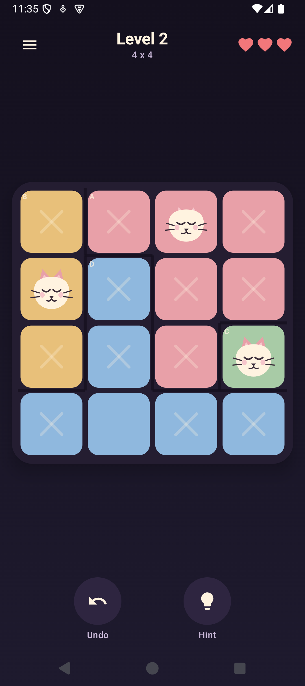

# Catdoku

A cozy offline cat logic puzzle for Android. Place one cat in every row,
column, and color region. Cats may not touch, not even diagonally.



Catdoku is inspired by cat-themed Queens puzzles. The name, art, palette,
copy, levels, and code are original. There is no Meowdoku branding or
content in this app.

## How to play

- Every row, column, and color region holds exactly one cat.
- Cats may not touch, including diagonally.
- Tap a cell to toggle an X note.
- Double-tap a cell to place or remove a cat.
- A wrong cat costs one heart. Three mistakes end the board.
- Tap Hint to highlight the next logically forced cat.
- Tap Undo to reverse notes and cat placements. Undo does not refund hearts.
- Optional auto-mark shows Xs for cells ruled out by placed cats.
- Optional region letters put a letter in each color region.
- Every puzzle has one solution and can be solved without guessing.

## Levels and daily puzzles

- 500 bundled levels ramp from 4 by 4 through 8 by 8.
- Levels are ordered by size and difficulty.
- A daily 7 by 7 puzzle is keyed to the UTC date.
- The daily streak is saved on the device.
- Progress, settings, the current level, and the current daily survive app
  restarts and process death.

## Build

Prerequisites: JDK 21, Android SDK, `adb`, and `just` on your `PATH`.

```bash
just build
```

Debug APK: `app/build/outputs/apk/debug/app-debug.apk`

## Install

```bash
just run
```

## Generated content

The puzzle pack and sound effects are committed, so a normal build does
not need Python. Regenerate them with:

```bash
just puzzles
just sounds
```

The puzzle generator verifies that every level has one solution and can be
solved by deterministic logic without guessing.

## Offline and private

- No internet permission and no network access.
- No ads, analytics, accounts, or tracking.
- All art, audio, and puzzle data are bundled in the APK.
- No runtime permissions.

## License

Licensed under either of

- MIT license ([LICENSE-MIT](LICENSE-MIT) or
  https://opensource.org/licenses/MIT)
- Apache License, Version 2.0 ([LICENSE-APACHE](LICENSE-APACHE) or
  https://www.apache.org/licenses/LICENSE-2.0)

at your option.
